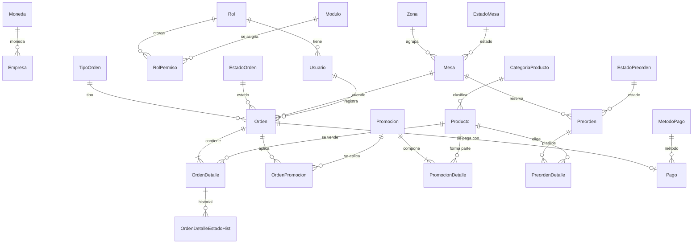

# Modelo de datos (3FN)

Tablas independientes: `Empresa` (una fila), `Parametro`, `Auditoria`.
Normalización: los atributos descriptivos viven en su catálogo (símbolo de moneda en `Moneda`, estados y métodos de pago en tablas propias); los totales de `Orden` son un resultado congelado al momento de la cuenta y los precios de `OrdenDetalle` conservan el precio vendido.
